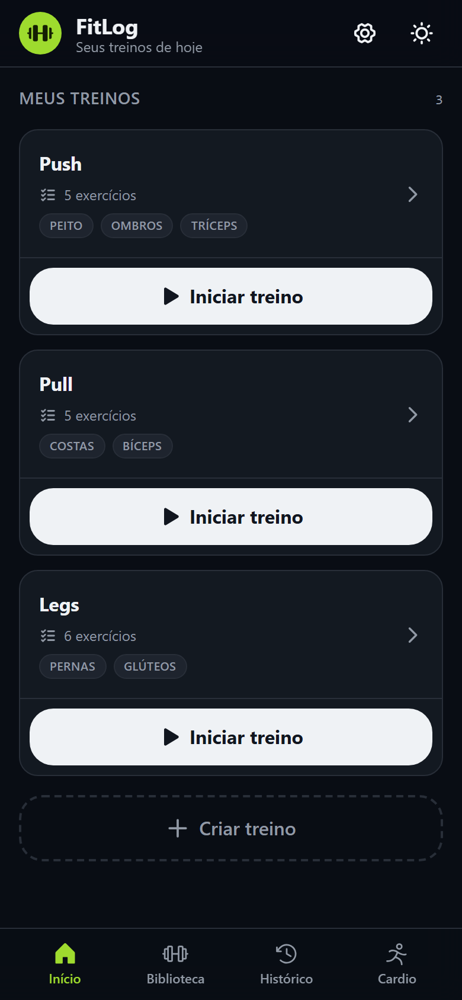
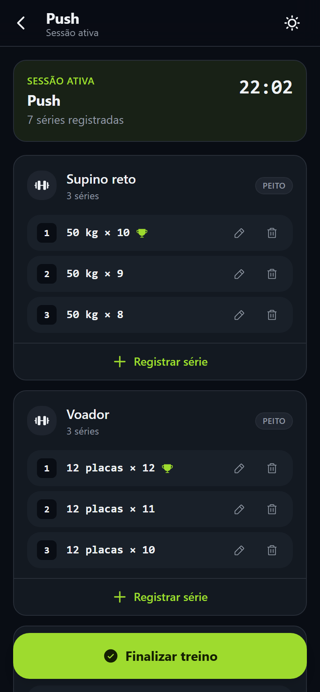
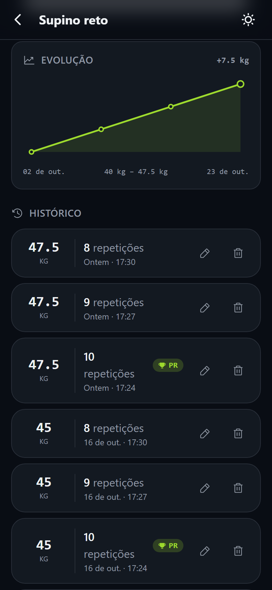
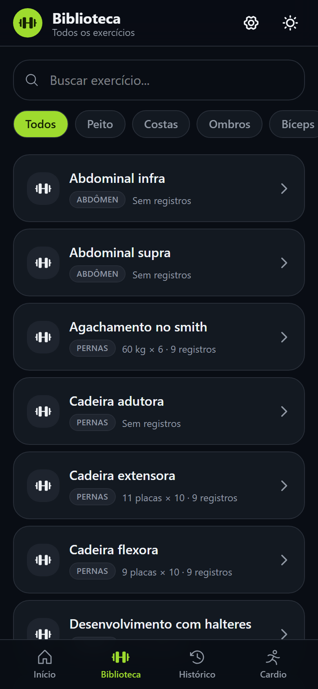
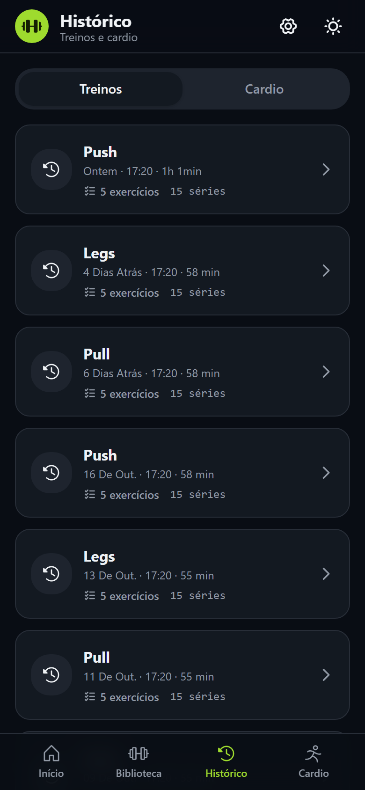
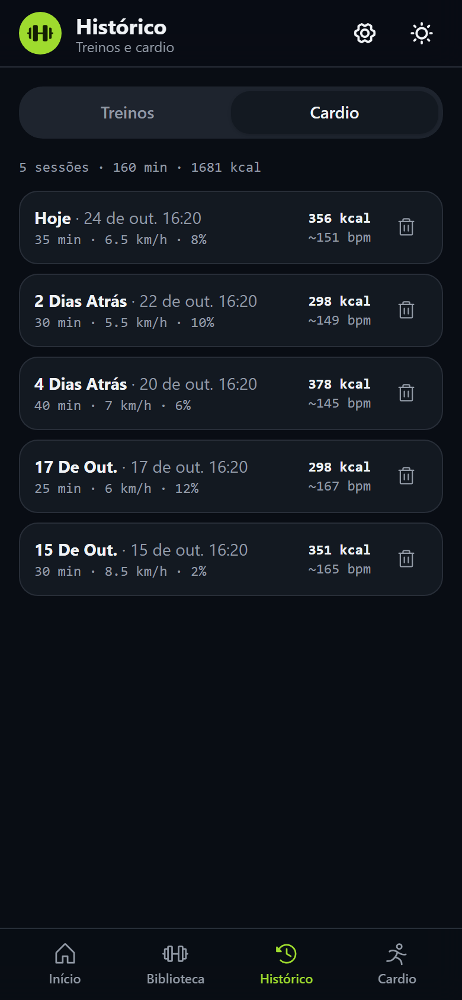
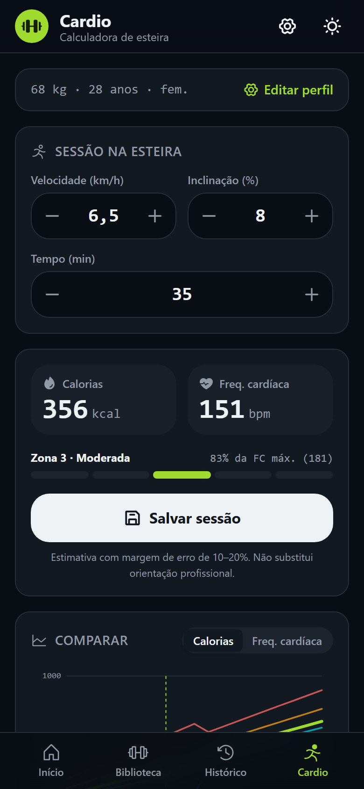
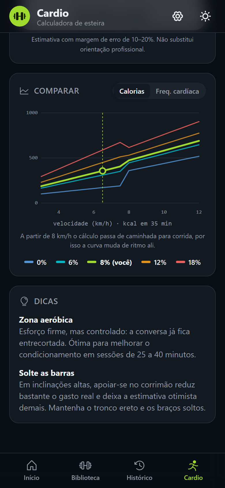
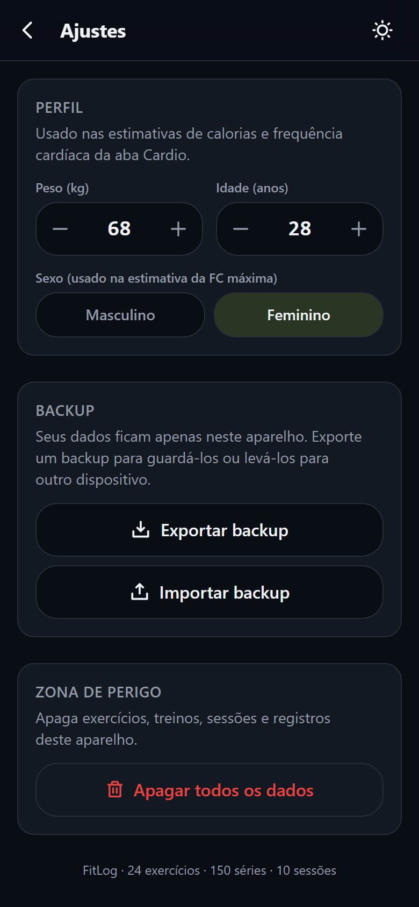

<div align="center">


# FitLog

**O diário de treino que cabe no bolso.**<br />
Registre séries, monte treinos, bata recordes, estime o gasto do cardio e veja sua evolução, sem cadastro e sem internet.

<br />

[](https://dn-fitlog.vercel.app)


</div>

<br />

## ✨ O que dá para fazer

| Recurso | Descrição |
|---|---|
| **Treinos prontos** | Agrupe exercícios em treinos (Push, Pull, Legs…), defina a ordem e inicie tudo com um toque. |
| **Sessão ao vivo** | Cronômetro do treino, séries por exercício e observações da sessão e de cada série. |
| **Timer de descanso** | Contagem regressiva de 60, 90, 120 ou 180 s depois de cada série, com vibração ao terminar. |
| **Carga sugerida** | A última série do exercício já vem preenchida, então você só ajusta o que mudou. |
| **Quatro tipos de carga** | Peso (kg), placas, peso corporal (com carga extra opcional) e tempo, para exercícios cronometrados. |
| **Calculadora de cardio** | Informe velocidade, inclinação e duração na esteira e veja calorias e frequência cardíaca estimadas, a zona de esforço e dicas para a intensidade. |
| **Comparador de esteira** | Gráfico com as curvas de 0%, 6%, 12% e 18% de inclinação (e a sua), em calorias ou frequência cardíaca, para ver o efeito de mudar velocidade ou inclinação. |
| **Perfil** | Peso, idade e sexo ficam salvos em Ajustes e alimentam as estimativas do cardio. |
| **Recordes e evolução** | Aviso na hora de um novo recorde, marca de PR no histórico, 1RM estimado e gráfico da melhor carga por dia. |
| **Biblioteca** | Busca, filtro por grupo muscular e 24 exercícios de exemplo. Exercícios com histórico são arquivados, não apagados. |
| **Histórico de sessões** | Duração, séries e anotações de cada treino concluído, com edição de qualquer série. Um seletor alterna entre **Treinos** e **Cardio**. |

<br />

## 📱 Telas

<table>
  <tr>
    <td align="center" width="33%">
      <br />
      <sub><b>Treinos</b></sub>
    </td>
    <td align="center" width="33%">
      <br />
      <sub><b>Sessão ao vivo</b></sub>
    </td>
    <td align="center" width="33%">
      <br />
      <sub><b>Evolução do exercício</b></sub>
    </td>
  </tr>
  <tr>
    <td align="center" width="33%">
      <br />
      <sub><b>Biblioteca</b></sub>
    </td>
    <td align="center" width="33%">
      <br />
      <sub><b>Histórico de treinos</b></sub>
    </td>
    <td align="center" width="33%">
      <br />
      <sub><b>Histórico de cardio</b></sub>
    </td>
  </tr>
  <tr>
    <td align="center" width="33%">
      <br />
      <sub><b>Calculadora de cardio</b></sub>
    </td>
    <td align="center" width="33%">
      <br />
      <sub><b>Comparador e dicas</b></sub>
    </td>
    <td align="center" width="33%">
      <br />
      <sub><b>Ajustes e perfil</b></sub>
    </td>
  </tr>
</table>

<br />

## 🔒 Seus dados

Tudo fica no `localStorage` do seu navegador. Não há conta, servidor nem rastreamento.

- Ao carregar, cada registro é validado: dados corrompidos ou editados à mão são descartados em vez de quebrar o app.
- Abas abertas ao mesmo tempo ficam sincronizadas.
- O app pode ser instalado e funciona offline na versão publicada (service worker).

> [!NOTE]
> Limpar os dados do navegador apaga o histórico. Em **Ajustes**, use **Exportar backup** para
> salvar um arquivo JSON (treinos, cardio e perfil) e **Importar backup** para restaurá-lo, inclusive em outro aparelho.
> Backups feitos antes da aba Cardio continuam sendo importados normalmente.

<br />

## 🧠 Como funciona

| Conceito | Regra |
|---|---|
| **Recorde (PR)** | Uma série é recorde quando a carga supera todas as anteriores do mesmo exercício e tipo de carga. A primeira série nunca conta. |
| **1RM estimado** | Fórmula de Epley (`carga × (1 + reps / 30)`), calculada sobre a melhor série em peso. |
| **Sessão** | Só uma sessão pode estar ativa por vez. Descartar apaga as séries dela, finalizar manda para o histórico. |
| **Arquivar** | Exercício com registros é arquivado ao ser removido. O histórico é mantido e ele pode ser restaurado em Biblioteca → Arquivados. |
| **Calorias do cardio** | Equações metabólicas da ACSM para caminhada (abaixo de 8 km/h) e corrida (a partir de 8 km/h), que estimam o consumo de O₂ pela velocidade e inclinação. O gasto sai de `O₂ × peso × 5 kcal/L × tempo`. |
| **FC estimada** | Esforço como fração da reserva de FC: VO₂máx de Uth–Sørensen e FC de repouso fixa em 70 bpm. FC máxima de Tanaka (`208 − 0,7 × idade`) para homens e de Gulati (`206 − 0,88 × idade`) para mulheres. |
| **Zonas** | Cinco zonas pela reserva de FC: muito leve (<40%), leve, moderada, intensa (≥80%) e máxima (≥90%). |

> [!NOTE]
> As estimativas do cardio são médias populacionais, com margem de erro de 10–20%, e não substituem orientação profissional.

<br />

## 🚀 Rodando localmente

Requer [Node.js](https://nodejs.org) e [pnpm](https://pnpm.io).

```bash
git clone https://github.com/diegonatalo/FitLog.git
cd FitLog
pnpm install
pnpm dev        # http://localhost:5173
```

Para testar no celular, use `pnpm dev --host` e abra o IP da sua máquina na mesma rede Wi-Fi.

| Comando | O que faz |
|---|---|
| `pnpm dev` | Servidor de desenvolvimento com HMR |
| `pnpm build` | Checa os tipos e gera o build de produção em `dist/` |
| `pnpm preview` | Serve o build de produção (o service worker só roda nele) |
| `pnpm lint` | Roda o ESLint |

<br />

## 🔑 Variáveis de ambiente

Veja [`.env.example`](.env.example).

| Variável | Descrição | Se não definir |
|---|---|---|
| `VITE_SITE_URL` | URL pública do site, usada no `canonical`, nas tags Open Graph, no `robots.txt` e no `sitemap.xml`. Sem barra no final. | Usa `https://dn-fitlog.vercel.app` |

<br />

## 🗂️ Estrutura

```text
src/
├── components/   interface reutilizável (LogForm, RestTimer, ProgressChart…)
├── context/      StoreProvider: o estado do app, lido com useStore()
├── hooks/        useWorkoutStore, usePersistedState, useTheme, useNow
├── lib/
│   ├── schema.ts     validação dos dados e formato do backup
│   ├── storage.ts    persistência e migrações versionadas
│   ├── defaults.ts   exercícios e treinos de exemplo
│   ├── stats.ts      recordes, 1RM e série histórica
│   ├── cardio.ts     calorias, FC estimada, zonas, comparação e dicas da esteira
│   ├── format.ts     datas, durações e cargas
│   └── paths.ts      rotas centralizadas
├── pages/        uma tela por rota
└── types.ts      modelos e metadados dos tipos de carga
public/           ícones, manifest, service worker e imagem Open Graph
```

<details>
<summary><b>Como adicionar um novo tipo de carga</b></summary>

<br />

1. Inclua o valor em `LoadType` e uma entrada em `LOAD_TYPES`, em `src/types.ts` (rótulo, unidade, passo e se tem repetições).
2. Associe um ícone em `ICONS`, em `src/components/LoadTypeToggle.tsx`.
3. Se a unidade tiver formato especial, trate-a em `loadParts`, em `src/lib/format.ts`.
4. O validador em `src/lib/schema.ts` já aceita qualquer valor de `LOAD_TYPES`.

</details>

> [!NOTE]
> O estado vive em um único hook (`useWorkoutStore`), servido por Context e persistido por
> `usePersistedState`. O React Compiler está ligado, então o código evita memoização manual.

<br />

## 🌐 Deploy

Publicado na [Vercel](https://vercel.com) em [dn-fitlog.vercel.app](https://dn-fitlog.vercel.app).

- O `vercel.json` reescreve todas as rotas para `index.html`, o que mantém funcionando o acesso direto a páginas como `/biblioteca`.
- O `robots.txt` e o `sitemap.xml` são gerados na build, em `vite.config.ts`. As rotas públicas listadas no sitemap são `/`, `/biblioteca`, `/historico` e `/cardio`; sessões ativas (`/sessao/`) ficam bloqueadas no robots.
- Ao trocar de domínio, defina `VITE_SITE_URL` (ou altere o valor padrão em `vite.config.ts`). Sem isso, o Open Graph, o `canonical` e o sitemap continuam apontando para o endereço antigo.

<br />

## 🧭 Próximos passos

- [ ] Testes automatizados (Vitest) para `lib/` e para as regras do store
- [ ] Séries de aquecimento e *drop sets*
- [ ] Medidas corporais e peso ao longo do tempo
- [ ] Calculadora de cardio para outros equipamentos (bicicleta, elíptico)
- [ ] Sincronização opcional entre dispositivos

> Hoje não há testes automatizados nem CI, e os dados existem apenas no aparelho onde foram registrados.

<br />

<div align="center">
  <sub>Feito com 💚 para treinar sem planilha.</sub>
</div>
